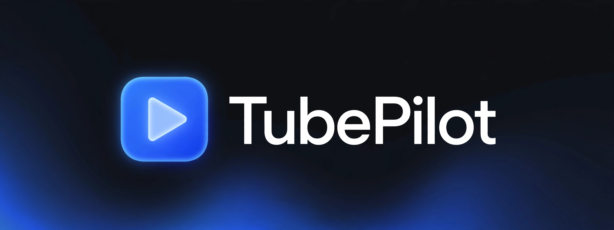

<p align="center"><a href="https://tubepilot-rho.vercel.app/">Sitio oficial</a></p>

<p align="center">
  <a href="README.md">English</a> ·
  <a href="README.ko.md">한국어</a> ·
  <a href="README.ja.md">日本語</a> ·
  <a href="README.es.md"><strong>Español</strong></a> ·
  <a href="README.pt.md">Português</a>
</p>

<p align="center">
  
</p>

<p align="center">
  <strong>Una forma más cómoda de ver YouTube.</strong><br>
  Salta los anuncios, omite los patrocinios y guarda videos con etiquetas para más tarde.
</p>

<p align="center">
  
  
  
  
  
</p>


---

## Un panel que deja espacio al vídeo

TubePilot añade segmentos, saltos y una biblioteca local al reproductor original de YouTube en escritorio. No necesitas una cuenta de TubePilot.

## Funciones

| Función | Descripción |
|---|---|
| Segmentos | Marcadores, línea de tiempo y lista con inicio/fin para patrocinios, intro, outro, autopromoción, llamadas a interactuar y música ajena al tema. Incluye salto manual. |
| Salto automático | Configuración general y por categoría. Desactivarlo conserva la información de segmentos. |
| Panel | `＋ / −` abre/cierra; `↗ / ↙` cambia entre vista amplia y compacta. Conserva el estado. Las instalaciones nuevas empiezan cerradas debajo del vídeo. |
| Anuncios | Intenta pulsar el botón de salto, avanzar y acelerar anuncios detectados. Puede silenciarlos y restaurar el estado de silencio y la velocidad anteriores. No garantiza eliminarlos. |
| Visualización | Zoom hasta 400%, desplazamiento al arrastrar y ocultación de comentarios. |
| Biblioteca | Vídeos con etiquetas y notas, búsqueda, filtros y recordatorio al volver a abrirlos. |
| Marcadores de intervalos | Guarda rangos con notas, salta a ellos y pausa al final. |
| Capturas | PNG del área visible del reproductor: archivo, portapapeles o ambos. Recorta una captura de la pestaña; no extrae fotogramas directamente. |
| Copias de seguridad | JSON con ajustes, biblioteca y marcadores. Restaurar sustituye ajustes y biblioteca; los marcadores incluidos también sustituyen los existentes. |

Interfaz en coreano, inglés, japonés, español y portugués. Cambia idioma, capturas y atajos en la ventana de la extensión.

## Instalación y actualización

1. Descarga y extrae el [ZIP de main](https://github.com/sapgun/tubepilot/archive/refs/heads/main.zip), o clona el repositorio.
2. Abre `chrome://extensions` o `edge://extensions` y activa el modo de desarrollador.
3. Elige **Cargar descomprimida** y selecciona `extension/`, la carpeta con `manifest.json`.
4. Recarga YouTube y pulsa `＋` en el panel situado debajo del vídeo.

Antes de actualizar, exporta una copia desde la biblioteca. Sustituye los archivos de la carpeta instalada, recarga la extensión y después YouTube. Evita copias duplicadas. El interruptor general se comprueba al cargar la página: recarga YouTube después de cambiarlo.

## Controles

- Los ajustes de reproducción incluyen categorías, zoom, posición, opacidad y acciones de guardar/biblioteca/captura/marcadores. Elige **debajo del reproductor** para no tapar el vídeo.
- Vista compacta: 340px. Vista amplia: ancho disponible debajo del vídeo o 540px si flota, limitado al ancho de pantalla.
- En modo flotante, arrastra la cabecera; doble clic restablece su posición y un clic abre/cierra. El panel se oculta en pantalla completa.
- Los marcadores llevan al inicio; **Saltar** lleva al final. El salto manual no está disponible durante anuncios detectados de YouTube.
- `Alt+S`: captura; `Alt+H`: comentarios; `Alt+B`: guardar. Son configurables.

## Datos, límites y privacidad

Los segmentos proceden de la comunidad mediante la [API de SponsorBlock](https://wiki.sponsor.ajay.app/w/API_Docs). No se analiza el contenido para descubrir anuncios sin reportar. La ausencia de datos y los errores de consulta se muestran por separado. Los anuncios de YouTube y los patrocinios dentro del vídeo tienen tratamientos distintos. Los cambios de YouTube pueden afectar al funcionamiento; no se garantiza compatibilidad con otras herramientas de anuncios. Sin afiliación a YouTube, ReVanced o SponsorBlock.

El [userscript](https://raw.githubusercontent.com/sapgun/tubepilot/main/tubepilot.user.js) **1.1.2** se mantiene separado de la extensión **1.10.1**. Se instala con Tampermonkey/Violentmonkey y no incluye el nuevo panel ni todas las funciones de la extensión. Firefox/Safari no están verificados. No ejecutes ambas ediciones a la vez.

Los ajustes, biblioteca y marcadores se guardan localmente. Las consultas envían el ID del vídeo a `sponsor.ajay.app`, que también recibe metadatos normales de red. No hay sincronización en la nube. Las copias exportadas incluyen vídeos y notas.

Permisos: `storage` para datos locales; `activeTab` para capturas de pestaña; `clipboardWrite` para copiar imágenes; `downloads` para guardarlas; `https://sponsor.ajay.app/*` para obtener segmentos. Las capturas pueden requerir una acción del usuario, como pulsar el icono de la extensión.

## Ayuda y contribuciones

Si falta el panel, activa la extensión, recarga y revisa debajo del vídeo o la posición guardada. Si faltan marcadores, revisa los ajustes, metadatos y estado de consulta. Para capturas, deja visible el reproductor y pulsa el icono si hace falta. [Informa de problemas](https://github.com/sapgun/tubepilot/issues) con versiones, pasos y URL del vídeo, sin datos privados.

```sh
cd extension/test
npm install
npm test
```

Las pruebas verifican funciones, ajustes y traducciones en un navegador simulado, no el éxito de saltar anuncios reales. Comprueba reproducción, pantalla completa, apertura/cierre y actualizaciones en el navegador de destino. [Historial](CHANGELOG.md) · [Licencia MIT](LICENSE)
